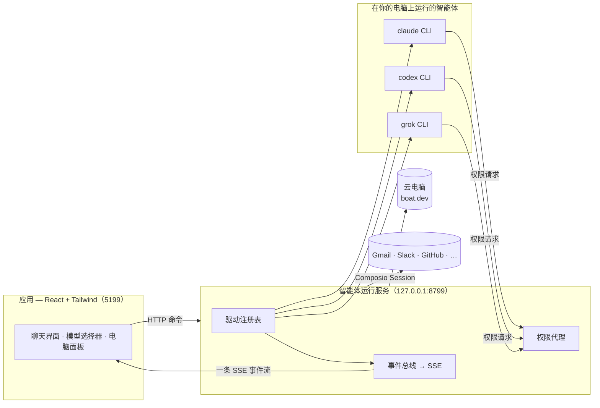

<div align="center">

# OpenMausBot

**Grok Bot 的开源替代方案：在一个聊天应用里，组建自己的 AI 机器人团队。**

[**openmausbot.com**](https://www.openmausbot.com) &nbsp;·&nbsp; [下载](https://www.openmausbot.com/download) &nbsp;·&nbsp; [Grok Bot 与开源替代方案对比](https://www.openmausbot.com/blog/grok-bot-vs-openmausbot)

<sub>OpenMausBot 是受 **Grok Bot** 启发的独立开源项目，也是 **Meta Muse**、**OpenAI dots** 和 **Cue by Manus** 的开源替代方案。它以本地运行为优先，支持接入你已有的智能体和模型。项目也称 **MausBot**，原名 **OpenGrokBot**，与 xAI、Meta、OpenAI 或 Manus 无隶属关系。</sub>

侧边栏里的每个机器人都由真实的智能体驱动。Claude 或 Codex 在本机运行，每个机器人都有自己的个性、模型、云电脑和已连接应用。你可以像和联系人聊天一样与它们交流，实时查看它们的工作进展，并审批需要你决定的操作。


[](https://github.com/milind-soni/OpenMausBot/releases/latest)


<br>

<a href="https://github.com/milind-soni/OpenMausBot/releases/latest/download/OpenMausBot.dmg">
  
</a>
&nbsp;
<a href="https://github.com/milind-soni/OpenMausBot/releases/latest/download/OpenMausBot-intel.dmg">
  
</a>
&nbsp;
<a href="https://github.com/milind-soni/OpenMausBot/releases/latest/download/OpenMausBot-setup.exe">
  
</a>
&nbsp;
<a href="https://github.com/milind-soni/OpenMausBot/releases/latest/download/OpenMausBot-amd64.deb">
  
</a>

<sub>[最新版本](https://github.com/milind-soni/OpenMausBot/releases/latest) &nbsp;·&nbsp; macOS：Apple 芯片及 Intel 版本，.dmg 已签名并通过 Apple 公证 &nbsp;·&nbsp; Windows：x64 安装程序 &nbsp;·&nbsp; Ubuntu 24.04 x64：.deb 或 AppImage（测试版） &nbsp;·&nbsp; Fedora x64：.rpm &nbsp;·&nbsp; [所有版本](https://github.com/milind-soni/OpenMausBot/releases)</sub>

<br>

<a href="https://github.com/sponsors/milind-soni">
  
</a>

<br>
<br>

<sub>由 <a href="https://boat.dev">boat.dev</a> 提供支持</sub>
<br>
<a href="https://boat.dev">
  <picture>
    <source media="(prefers-color-scheme: dark)" srcset="docs/assets/sponsors/boat-logo-white.svg">
    
  </picture>
</a>

<br>
<br>

<sub>推理服务赞助商</sub>
<br>
<a href="https://modelgo.ai/?utm_source=openmausbot&utm_medium=sponsorship&utm_content=readme&campaign_id=openmausbot&ad_group_id=readme">
  <picture>
    <source media="(prefers-color-scheme: dark)" srcset="docs/assets/sponsors/modelgo-logo-white.svg">
    
  </picture>
</a>

<br>
<br>


</div>

---

> ⚠️ **本项目与任何加密货币无关。** OpenMausBot 没有自己的代币。任何冠以 OpenMausBot、Maus 或 SupaMaus 名称的代币，都与本项目及维护者无关，也不是由本项目或维护者创建或背书的。我没有从任何人那里收到代币、款项或代币配额，也不会为任何代币背书。

## 为什么做 OpenMausBot

把一个助手放进一个对话框，并不适合发挥多个智能体的能力。OpenMausBot 是受 **Grok Bot** 启发的独立开源项目，延续了把 AI 放进即时通讯应用的思路。你可以与列表里的多个机器人聊天，每个机器人都有自己的个性、会话记忆、模型、电脑和应用。OpenMausBot 用开源、本地优先的方式实现这一体验，并接入你已有的智能体。

- **接入已有的智能体。** 机器人通过你电脑上安装的 `claude`、`codex` 和 `grok` CLI 运行。沿用现有登录和订阅，无需注册新账号，也没有中间代理。在 **设置 → AI → 提供方** 中，可以为任意引擎指定自定义 CLI 可执行文件，例如特定版本的构建产物或包装程序。
- **本地优先。** 一个运行在 `127.0.0.1` 的轻量级智能体运行服务管理所有智能体进程。会话记录、密钥和事件都保存在本机的 `~/.openmausbot` 中。
- **机器人可以操作电脑。** 每个机器人都能使用云端 Linux 桌面或隔离的本地虚拟机（Local VM）。在安全边界已通过验证的平台上，机器人也可以操作你自己的电脑。此外，还可以通过 Composio 使用 500 多种应用。macOS 和 Ubuntu Xorg 上的本机控制需要明确启用。Ubuntu Wayland 上的本机控制在问题 #345 解决前仍处于禁用状态。

## Grok Bot、Muse、dots 和 Cue 的开源替代方案

2026 年，四款闭源个人智能体产品在七周内相继推出。它们的模型、电脑和用户数据都由各自的厂商掌控。OpenMausBot 以开源方式实现了同类体验：一个聊天应用容纳一支智能体团队，每个智能体都有自己的模型、电脑和已连接应用。项目在你自己的电脑上运行，采用 Apache 2.0 许可证。如果你在找 Muse、dots、Grok Bot、Instinct 或 Cue 的开源替代方案，可以从这个仓库开始。

| 你在找什么 | 原产品 | OpenMausBot 的区别 | 了解更多 |
| --- | --- | --- | --- |
| **Grok Bot 开源替代方案** | xAI 的多个机器人共用一台云电脑，仅支持 Grok，需要 SuperGrok 或 Cursor 套餐 | 同样提供多个机器人，可为每个机器人选择任意模型，在自己的电脑上运行，并通过审批卡片授权 | [Grok Bot 与 OpenMausBot 对比](https://www.openmausbot.com/blog/grok-bot-vs-openmausbot) |
| **Muse 开源替代方案** | Meta 的单个个人智能体，运行在 Meta 的云虚拟机中，仅在美国和加拿大提供 | 提供一支智能体团队，可在任意地区运行，数据保存在 `~/.openmausbot` | [Meta Muse 替代方案](https://www.openmausbot.com/blog/open-source-alternative-to-meta-muse) |
| **dots 开源替代方案** | ChatGPT 内持续运行的 OpenAI 智能体，仅支持 GPT，面向 Pro 和 Business Premium 套餐 | 支持多个智能体，可沿用 Claude、ChatGPT 或 Grok 的登录，无需订阅指定套餐 | [OpenAI dots 替代方案](https://www.openmausbot.com/blog/openai-dots-alternative) |
| **Cue 开源替代方案** | Manus 的邀请制智能体，拥有自己的电话、邮箱和钱包 | 无需邀请，使用 OAuth 授权，无需提供密码，项目开源 | [Cue by Manus 替代方案](https://www.openmausbot.com/blog/open-source-alternative-to-cue-by-manus) |
| **Instinct 开源替代方案** | Spear Street 的邀请制智能体，把你的密码保存在云电脑上 | 可按需要求审批，通过 OAuth 登录，在你自己的电脑上运行 | [Instinct AI 替代方案](https://www.openmausbot.com/blog/instinct-ai-alternative) |

五款产品的横向对比见 [Muse、Grok Bot、dots 和 Cue 对比](https://www.openmausbot.com/blog/muse-vs-grok-bot-vs-dots-vs-cue)。
也可以通过五个问题选出适合自己的工具：[我该用哪款 AI 智能体？](https://www.openmausbot.com/blog/which-ai-agent-should-i-use)

## 功能

<table>
<tr>
<td width="50%" valign="top">

### 🧠 为每个机器人选择模型

模型选择器带有提供方侧栏，可并列查看 Claude 和 Codex 的模型。默认模型会明确标注，暂不可用的提供方会置灰并说明原因。聊天过程中也可以切换机器人的模型。


</td>
<td width="50%" valign="top">

### 🖥️ 每个机器人都有自己的电脑

打开电脑面板，机器人的云桌面就会自动启动。你可以实时查看它的屏幕，点击「打开桌面」在浏览器中接管，也可以让机器人改用当前这台 Mac。


</td>
</tr>
<tr>
<td width="50%" valign="top">

### 🙋 机器人操作前会征求你的意见

Shell 命令、文件编辑和机器人提问都会以卡片形式直接显示在聊天中，你可以选择允许、拒绝或直接回答。无论操作发生在云电脑还是本机，都由权限代理把有风险的操作交给你决定。


</td>
<td width="50%" valign="top">

### 🔌 已连接应用

通过基于 Composio Sessions 的应用市场，可以一键接入 Gmail、Slack、GitHub、Notion、Linear 等数百款应用。完成一次 OAuth 授权后，每个机器人都能把这些应用当作工具使用。


</td>
</tr>
<tr>
<td width="50%" valign="top">

### 🗂 像管理聊天一样管理机器人

右键点击任意机器人，即可置顶、标为未读、编辑资料、创建副本、复制会话 ID、隐藏或删除。机器人在聊天应用里就像你的联系人。


</td>
<td width="50%" valign="top">

### 🔑 凭据只需配置一次

在应用设置中粘贴凭据后，凭据会保存在本地，所有提供方会立即重新加载配置，无需重启。界面只显示密钥是否已配置，不会回显密钥本身。


</td>
</tr>
</table>

### #️⃣ 用频道划分工作场景

工作、个人事务和各个项目都可以放进独立的频道，无需为每个频道复制机器人。每个频道都有独立的会话记录、共享指令、工作目录、回复规则和可编辑的机器人名单。你可以把频道和相关机器人归入一个命名分组，并随团队变化重命名分组或调整成员。

### ⚡ 用 Jev 快速决定由谁回复

在 **设置 → AI → 分配和提取** 中配置以下任意一项：Cloudflare Workers AI 令牌及对应的账号 ID、TypeSafe Jev 密钥，或 OpenRouter 密钥及模型。将频道设为 **由 MausBot 决定（Auto）** 后，如果消息没有 @ 任何机器人，系统就会在几百毫秒内选出合适的回复者。决策模型关闭或无法确定时，由频道负责人接手。详见 [docs/decision-model.md](docs/decision-model.md)。

### 📦 用一个 Markdown 文件安装整支团队

在 [BotMRR](https://botmrr.io) 浏览按工作目标组织的团队，选好后点击 **添加到 OpenMausBot（Add to OpenMausBot）**。应用会先打开预览确认界面，然后才创建机器人、总协调机器人（Chief of Staff）、频道、工作手册、连接器检查清单和建议的例行任务。你也可以在 **团队 → 导入** 中导入本地的同一份 `.md` 文件，或粘贴它的公开 GitHub 链接。

这种格式可在不同工具之间使用。OpenMausBot 读取文件开头结构化的 YAML 元数据（frontmatter），以便可靠地一键安装。Grok、Claude、ChatGPT 和用户都可以直接按 Markdown 正文中的工作手册操作。应用连接在你批准前保持关闭，导入的例行任务默认暂停。团队包不包含凭据、会话、权限设置、记忆或电脑访问权限。详见[开源工作手册仓库](https://github.com/milind-soni/openmausbot-teams)和[可移植格式规范](https://github.com/milind-soni/openmausbot-teams/blob/main/FORMAT.md)。

### 🤝 分享单个机器人或整个部门

你可以对机器人说「把你自己发布到 GitHub」，也可以打开部门的 **…** 菜单，选择 **分享**。分享卡片包含机器人及其指令、技能和图片，以及群聊、已暂停的例行任务和总协调机器人。所用应用只列出名称。聊天内容、记忆、密钥和连接地址均不会打包。点击 **发布**，可将团队包发布到 GitHub 上的社区仓库并获得链接。选择 **保存文件夹…**，则会将团队包存到本机。其他人可通过 **+ → 导入…** 使用链接或文件夹添加。详见 [docs/team-sharing.md](docs/team-sharing.md)。

已连接到组织的桌面应用也能在 **模板** 中看到管理员分享的团队包。一键添加后，包里的技能会启用。详见 [docs/org-library.md](docs/org-library.md)。

### 🎧 与机器人语音交流

点击任意回复旁的扬声器即可收听，也可以让机器人在每条回复送达时自动朗读。这样，你早上准备早餐时也能听它汇报夜里完成了什么。点击 **通话** 即可和它对话。它能听你说话，边工作边汇报进展，并用语音征求你的批准。

在智能体资料中，可以选择 ElevenLabs、Fish Audio、Grok（xAI）、Mac 内置语音，或本地 Chatterbox 服务。按需要配置一次云服务密钥，再选择音色，每个机器人就都能开口说话。为机器人设置不同的音色后，只听声音也能分辨频道里是谁在回复。

要使用 Grok 语音，先在 **设置 → AI** 保存 xAI API 密钥，再到机器人的 **语音与提醒** 中选择 **Grok（xAI）** 及音色。它会复用保存在宿主机上的密钥，为朗读回复和通话返回 MP3 音频。系统会从回复文本自动识别语言。对于官方支持范围之外的语言，合成效果可能因语言而异，详见 [xAI 官方支持的语言](https://docs.x.ai/developers/model-capabilities/audio/text-to-speech)。这个集成给现有通话流程加入了语音合成，麦克风语音转文字的方式保持不变。

**还有这些功能：** 流式回复中会显示工具运行状态标签。桌面应用在输入框提供麦克风听写，macOS 使用 Apple 的端侧语音识别，Windows 和 Linux 使用 Fish Audio 语音转文字。SupaMaus 光标吉祥物会随角色改变表情。机器人的工作截图也会随会话保留。

## 技术与服务

<div align="center">


</div>

| 服务 | 用途 |
|---|---|
| **Claude · Codex · Grok** | 为机器人提供底层智能体，通过各自的本地 CLI 运行 |
| **Electron** | macOS、Windows 和 Ubuntu 的桌面外壳 |
| **React + Vite + Tailwind CSS** | 聊天应用界面及其构建工具链 |
| **Boat**（[boat.dev](https://boat.dev)） | 为每个机器人提供云电脑，也是项目赞助商 |
| **ModelGo**（[modelgo.ai](https://modelgo.ai/?utm_source=openmausbot&utm_medium=sponsorship&utm_content=readme&campaign_id=openmausbot&ad_group_id=readme)） | 用一把 API 密钥访问所有模型，也是项目的推理服务赞助商 |
| **Composio** | 连接 Gmail、Slack、GitHub 等应用 |
| **Cua Driver** | 在你自己的电脑上提供原生电脑操作能力 |
| **ElevenLabs · Fish Audio** | 为机器人提供托管语音服务 |
| **GitHub Sponsors** | 通过一次性捐助或每月赞助支持项目 |

## 工作原理

应用和智能体运行服务分别运行在两个进程中。客户端没有独立的传输层，它通过 HTTP 发送带类型定义的命令，并用一条 SSE 事件流更新状态。智能体运行服务管理所有智能体进程，把不同提供方的原生协议统一转换为一种运行时事件流，并按会话记录为 NDJSON。



| 层级 | 位置 | 职责 |
|---|---|---|
| 驱动 | `server/drivers/` | Claude、Codex 和 Grok Build 各有一个驱动，通过本地 CLI 通信（依次使用 stream-JSON、JSON-RPC 和 ACP）。此外还提供云电脑智能体。遇到未知驱动时将其标为「不可用」，其余驱动可以继续运行。 |
| 智能体运行层（Harness） | `server/harness/` | 驱动注册表根据配置创建运行实例。事件总线汇聚各路事件，供所有客户端更新状态。 |
| API | `server/index.ts` | 通过 HTTP 和 SSE 提供机器人、交互轮次、审批、模型目录、电脑生命周期、连接器和配置功能。 |
| 语音 | `server/tts/` | 支持 ElevenLabs、Fish Audio、Grok（xAI）、Mac 内置语音和本地 Chatterbox。云服务密钥保存在智能体运行服务中，Markdown 会先转换为适合口播的文本再朗读。 |
| 应用 | `src/` | 提供聊天界面。状态存储以服务端为后端，由一个 reducer 更新，客户端没有独立的传输层。 |
| 桌面端 | `electron/` | 为 macOS、Windows 和 Ubuntu 提供桌面外壳，内嵌智能体运行服务，并接入各平台的原生能力。Apple 语音功能仅用于 macOS。Ubuntu Xorg 允许明确启用本机控制，Wayland 在安全条件未满足时保持禁用。 |

### 通过 MCP 编排 OpenMausBot

OpenMausBot 提供一个通过标准输入输出（stdio）通信的 MCP 服务器，供 Claude Desktop、Cursor 等外部客户端使用。团队管理接口的范围经过限制，可查看机器人和频道，分页读取或搜索精简的会话记录，创建和配置机器人、频道及任务，派发工作、等待完成、切换模型和中断交互轮次。接口不开放审批授权、删除操作、任意设置项、凭据或电脑生命周期管理。

详见 [MCP 服务器配置与工具参考](docs/mcp-server.md)。

### 在脚本和 CI 中运行

`openmausbot` 命令可以在无图形界面的情况下操作正在运行的工作区。它可以从文件配置团队，给一个机器人派发工作，等待该机器人及它委派的所有队友完成，再导出成果。使用 `--json` 可输出一份 JSON 文档，脚本也可以根据退出码决定后续操作。

```sh
openmausbot team apply team.yaml
openmausbot run "Room Lead" "Rehearse the launch of https://example.com" --export ./out
```

详见[在脚本和 CI 中运行 OpenMausBot](docs/headless-cli.md)。

## 快速开始

**使用发布版本（[最新版本](https://github.com/milind-soni/OpenMausBot/releases/latest)）。** 安装包已内嵌智能体运行服务，无需另外配置。

| 平台 | 下载 | 安装 |
|---|---|---|
| **macOS**（Apple 芯片） | [OpenMausBot.dmg](https://github.com/milind-soni/OpenMausBot/releases/latest/download/OpenMausBot.dmg) | 将应用拖到「应用程序」文件夹，然后打开。已签名并通过 Apple 公证。 |
| **macOS**（Intel） | [OpenMausBot-intel.dmg](https://github.com/milind-soni/OpenMausBot/releases/latest/download/OpenMausBot-intel.dmg) | 同一款应用，专为 Intel Mac 构建。已签名并通过 Apple 公证。 |
| **Windows**（x64） | [OpenMausBot-setup.exe](https://github.com/milind-soni/OpenMausBot/releases/latest/download/OpenMausBot-setup.exe) | 运行安装程序即可一键安装到当前用户，无需管理员权限。安装程序尚未进行代码签名，因此 SmartScreen 会显示「未知发布者」，可选择 **更多信息 → 仍要运行**。默认安装到 `%LOCALAPPDATA%\Programs\OpenMausBot`。更新总会写入安装程序记录的目录，请将应用保留在原安装位置。如果手动移动了应用（例如从 C 盘移到 D 盘），移走的副本不会更新，下次更新仍会写入原目录。 |
| **Ubuntu 24.04**（x64） | [OpenMausBot-amd64.deb](https://github.com/milind-soni/OpenMausBot/releases/latest/download/OpenMausBot-amd64.deb) · [OpenMausBot.AppImage](https://github.com/milind-soni/OpenMausBot/releases/latest/download/OpenMausBot.AppImage) | 建议通过 APT 安装 `.deb` 包，也可以给 AppImage 添加执行权限后直接运行。当前为测试版，支持 GNOME 桌面。 |
| **Fedora**（x64） | [OpenMausBot-x86_64.rpm](https://github.com/milind-soni/OpenMausBot/releases/latest/download/OpenMausBot-x86_64.rpm) | 运行 `sudo dnf install ./OpenMausBot-x86_64.rpm` 安装。Fedora 由社区提供支持，项目在 Ubuntu 上进行 Linux 测试。 |

安装方法、功能支持和故障排查见 [Ubuntu 桌面指南](docs/linux-desktop.md)。
任何桌面版本也可以通过 Tailscale 使用另一台 Windows、macOS 或 Ubuntu 电脑上的机器人，详见[在另一台电脑上打开本机的机器人](docs/desktop-companion.md)。

**从源码运行**

```sh
git clone https://github.com/milind-soni/OpenMausBot && cd OpenMausBot
pnpm install

pnpm dev:server    # 智能体运行服务 → 127.0.0.1:8799
pnpm dev           # 应用 → http://127.0.0.1:5199
pnpm dev:desktop   # Electron 桌面外壳（保持上面两个命令继续运行）
```

系统要求为 **macOS、Windows 或 Ubuntu 24.04 x64**，并需安装 **Node 24 或更高版本**及 **pnpm**。至少安装并登录一个智能体 CLI：[`claude`](https://claude.com/claude-code)、[`codex`](https://github.com/openai/codex) 或 [`grok`](https://x.ai/cli)。已准备好的 CLI 会自动显示在模型选择器中。

使用以下命令打包桌面应用。

```sh
pnpm package:mac      # macOS：DMG + ZIP，需要 Swift/Xcode 工具
pnpm package:win      # Windows：安装程序 + ZIP
pnpm package:linux    # Linux x64：.deb + .rpm + AppImage + 已验证的 CUA 运行时
```

### 桌面端功能支持情况

| 功能 | macOS | Windows x64 | Ubuntu 24.04 Xorg | Ubuntu 24.04 Wayland |
|---|---|---|---|---|
| 打包后的应用、内嵌智能体运行服务、本地智能体 CLI | 支持 | 支持 | 测试版 | 测试版 |
| Composio 和 Boat 云电脑 | 支持 | 支持 | 测试版 | 测试版 |
| 用户主动开启的本机屏幕捕获（仅预览） | 支持 | 不可用 | 测试版 | 测试版 |
| 机器人控制这台电脑 | 支持 | 支持 | 测试版，需明确启用 | 受 Wayland 安全限制，已禁用（Omarchy 搭配 Cua 的 Hyprland 插件属于实验性支持） |
| 原生端侧听写 | 支持 | 不可用 | 已列入计划 | 已列入计划 |
| 通过 Fish Audio 进行听写和「轮流说话」通话（需要 Fish Audio 密钥） | 使用端侧识别 | 支持 | 支持 | 支持 |

在 Windows 上，选择 **这台电脑** 即可让机器人控制本机桌面。安装包内置 CUA 驱动和 SDK，无需单独安装 Cua。即使上表中仅用于预览的屏幕捕获功能不可用，机器人仍可控制本机。详见[电脑与浏览器操作](docs/computer-use-integration.md)。

Linux 的屏幕预览由用户主动开启。开启预览不会启用机器人本机控制或自动分配。在 Xorg 上，经审查的 Cua Driver 0.41.3 运行时仅在用户明确授权后启动，并且不使用全屏光标覆盖层。在 Wayland 上，应用不会启动该运行时。真实桌面会话的安全限制尚未解除，应用会清除旧的启用设置。两类会话都可以聊天、预览屏幕、使用云电脑和本地虚拟机。详见 [Ubuntu 桌面指南](docs/linux-desktop.md)和跟踪问题 [#29](https://github.com/milind-soni/OpenMausBot/issues/29)、[#345](https://github.com/milind-soni/OpenMausBot/issues/345) 和 [#113](https://github.com/milind-soni/OpenMausBot/issues/113)。

Linux 打包工具只在构建期间下载与指定上游标签对应的归档文件，并验证文件大小、SHA-256、归档内全部条目是否符合白名单，以及内部可执行文件的哈希值。验证后只打包 CLI 与随附的光标主题组件。应用安装后不会下载或自行更新原生自动化代码。运行时随附 Cua 的 MIT 许可声明、Inter 的 SIL OFL 许可证、自动生成的第三方许可证报告，以及一份 CycloneDX 格式的组件清单。经审查的来源记录见 [`third_party/cua-driver/`](third_party/cua-driver/)。

以下凭据均为可选，本地聊天无需配置。需要使用某项集成时，点击侧边栏底部的齿轮打开 **应用设置**，粘贴对应密钥即可。

| 凭据 | 启用的功能 | 获取方式 |
|---|---|---|
| Composio 项目密钥（`ak_…`） | 为机器人接入 Gmail、GitHub、Slack、Notion 等应用 | [OpenMausBot Composio 配置指南](docs/composio.md) |
| Boat API 密钥 | 为机器人提供隔离的远程 Linux 电脑，带桌面和终端 | [Boat API 密钥指南](https://docs.boat.dev/api-keys) |
| ElevenLabs 密钥 | 朗读回复并与机器人通话 | [ElevenLabs API 密钥](https://elevenlabs.io/app/settings/api-keys) |
| Fish Audio 密钥 | 使用 Fish Audio 的音色朗读回复，并与机器人通话 | [Fish Audio API 密钥](https://fish.audio/app/api-keys/) |

Composio 和 Boat 都是第三方服务，各有自己的账号和服务条款。Boat 试用结束后需要付费，使用云电脑可能产生费用。

```sh
pnpm typecheck     # 检查应用和服务端的类型
pnpm test          # 单元、驱动、API 和桌面端功能测试
pnpm build         # 类型检查 + 生产构建
pnpm check:electron # 检查 Electron 主进程和预加载文件的语法
pnpm package:win   # Windows 安装程序 + ZIP → release/
pnpm package:linux # Linux x64 .deb + .rpm + AppImage → release/
```

### 触发条件：定时任务和 Webhook

满足触发条件时，机器人就会执行指定操作。比如对机器人说「每个工作日上午 9 点给我发一份收件箱摘要」，或者「每当表单发来请求，就起草一份回复」，它会在当前交互轮次内用 `trigger` 工具创建触发条件，无需确认。聊天中会显示一张可操作的卡片，支持编辑、暂停和撤销。侧边栏第一项 **触发条件** 会列出所有定时任务和 Webhook，并提供日历及运行历史。机器人通过 `trigger_info` 查看列表和应用事件，通过 `trigger` 创建、更新、暂停、恢复或立即运行，也可以通过 `delete_trigger` 删除触发条件。机器人创建 Webhook 时看不到其密钥，用户可从卡片或「触发条件」页面复制链接。

定时任务在应用中称为「例行任务」。它可以只运行一次、在一周内指定的几天运行，或每隔 5 至 1,440 分钟运行。任务可以使用为机器人配置的模型和电脑，也可以交给云虚拟机执行。按固定间隔运行的任务以所选开始时间为基准。若上一次执行还未结束，本次就会跳过，避免耗时任务造成队列无限堆积。高级设置中可另行设定运行时限，安全停止卡住的任务。默认不设超时。现有的「时长」字段仅用于日历和界面展示。Webhook 触发条件独立于定时任务，但共用同一个排队任务执行器，也同样在日历中留下运行记录。

**应用事件**会在已连接应用中发生指定事件时启动机器人，例如「每当收到 Acme 的邮件，就起草一份回复」。机器人通过 `trigger_info`（`action: "events"`）查找应用支持的事件，然后调用 `trigger`，传入 `action: "create"` 和 `when: "app_event"`。用户也可以选择 **新建 → 自己设置 → 当应用中发生某件事时**。Composio 会把事件发送到 OpenMausBot 的应用连接服务，服务将事件排入队列。桌面应用通过长轮询取回事件，因此无需公开地址。应用关闭期间，事件仍会在队列中等待。Gmail 每 15 分钟检查一次。Slack、GitHub 等支持推送的应用会即时送达事件。桌面端每天最多保留 500 个事件，付费 Cloud 每天最多 2,000 个，跳过的事件会显示在对应的自动化任务中。应用事件需要使用内置的应用连接功能。使用自有 Composio 密钥的服务器暂不能监听应用事件。详见 [docs/composio.md](docs/composio.md#app-events)。

OpenMausBot 默认在 `127.0.0.1:8800` 启动一个专用的 Webhook 接收服务。设置了 `OMB_PORT` 时，接收端口默认为该端口号加 1。也可以用 `OMB_WEBHOOK_PORT` 指定其他端口。Webhook 密钥只会在创建触发条件或轮换密钥时显示一次。建议使用 Bearer 认证，避免密钥出现在请求 URL 和大多数访问日志中。无法配置请求头的发送方也可以使用一条自带授权的专用 URL。接收服务只暴露 `/health` 和带密钥的 `/hooks/...` 端点，应用的其他 API 不会通过这个服务暴露。OpenMausBot 必须保持运行才能接收请求。若要从公网接收请求，请通过托管中继或 Tailscale Funnel 等工具，仅代理这一专用接收服务。

## 项目状态

项目仍处于早期阶段，端到端流程已能运行：发送消息 → 智能体处理 → 流式回复 → 工具调用 → 审批 → 电脑操作。macOS、Windows 和 Ubuntu 24.04 x64 均已有发布版本。Ubuntu 仍处于测试阶段，功能限制见上文。托管服务与移动端的连接能力仍在开发中。Webhook 触发条件目前依赖本地接收服务，尚未使用常驻的托管中继。

使用托管语音需要 ElevenLabs、Fish Audio 或 xAI 密钥。Mac 内置语音和本地 Chatterbox 无需云服务密钥。macOS 上的「轮流说话」通话和输入框麦克风均使用端侧语音识别，Windows 和 Linux 则使用 Fish Audio 语音转文字，与语音合成共用同一个 Fish Audio 密钥。设计和已知限制见 [`docs/voice-mode.md`](docs/voice-mode.md)。

欢迎参与贡献。[`server/contracts.ts`](server/contracts.ts) 中的驱动服务提供者接口（SPI）保持精简。新增提供方只需在 [`server/drivers/`](server/drivers/) 下添加一个文件，再加一行注册代码。

自定义引擎无需编写代码。支持 ACP 的任意 CLI 或兼容 OpenAI 的端点都能通过配置接入，详见 [`docs/custom-engines.md`](docs/custom-engines.md)。

用户也可以通过配置添加自己的 MCP 工具服务器，详见 [`docs/custom-mcp-servers.md`](docs/custom-mcp-servers.md)。

关于配置开关、默认值以及对模型调用的影响，见[功能开关](docs/feature-flags.md)。

如需让机器人使用 OpenRouter、Fireworks AI、DeepSeek、Cline 或兼容 OpenAI 或 Anthropic 的自有服务，见[其他模型提供方](apps/docs/content/docs/providers/model-providers.mdx)。

## 隐私

使用分析是可选的，数据以匿名方式收集。收集内容包括产品使用事件和每天一次的已配置项目计数，绝不收集密钥、姓名、地址或会话。可在 **设置 → 通用 → 隐私** 中关闭「使用分析」。所有事件及其属性见 [`docs/analytics.md`](docs/analytics.md)。

## 支持项目

OpenMausBot 免费且开源。如果它在工作中帮到了你，可以通过 [GitHub Sponsors 支持开发](https://github.com/sponsors/milind-soni)，选择一次性捐助或按月赞助。你的支持将用于持续开发和维护，OpenMausBot 会继续保持免费和开源。

## 从终端运行或部署到服务器

使用 Node 24 或更高版本，安装一次即可运行。

```sh
npm install -g openmausbot
openmausbot
```

也可以直接运行 `npx openmausbot`，无需全局安装。首次启动时，用方向键按提示选择 AI 接入方式，然后登录或粘贴输入时隐藏的 API 密钥，再选择模型。你也可以选择连接手机。下次运行同一命令时，会沿用已保存的配置，在这台电脑上打开 OpenMausBot。请保持终端开启。按 Ctrl-C 会停止服务器，已保存的工作会保留。使用 `--no-open` 可跳过打开浏览器。

手机访问是可选项，默认跳过。可以使用经你明确批准且受配对保护的托管公网 HTTPS 端点、已有的 Tailscale 连接，或自有的 HTTPS 反向代理。Android 和 iOS 的原生应用都可通过这个流程配对。连接 Android 手机时，二维码指向应用链接。iOS 应用同时接受这种应用链接和网页链接。两种手机也都可以通过浏览器访问，但不能使用 localhost 链接。`--local` 让本次启动忽略已保存的远程访问设置。`--no-pair` 隐藏手机配对提示和邀请，但不会禁用已保存的远程连接。

也可以在 Safari 或 Chrome 中把网页界面安装为独立的手机应用。如何添加到主屏幕及完成配对，见[安装手机版网页应用](docs/phone-web-app.md)。

运行 `openmausbot setup` 可重新配置，同时保留机器人和会话。保存的默认模型只适用于新建机器人。选择通过本机 CLI 接入时，设置流程会确认提供方的登录状态。选择 API 接入时，系统会在发送可能计费的测试消息前询问。

通过 `openmausbot setup` 或服务器配置的 API 密钥，以明文保存在仅供当前用户访问的 `config.json` 中（Unix 权限为 `0600`）。打包后的桌面应用会通过操作系统加密存储 AI 提供方和各项服务的密钥。它的 `config.json` 仍以明文保存 OpenCode 提供方密钥、单独提供给某个引擎的密钥以及 MCP 请求头的值。机器人通过密钥卡片设置的密钥会保存在保险库（Vault）中，`config.json` 只保存引用。账号差异、手机连接方式、凭据存储和取消流程见[快速配置指南](docs/cli-onboarding.md)。

若要在 VPS 或长期开机的电脑上部署服务器，请运行 `npx openmausbot serve`，并选择一种访问方式：在自有的 cloudflared、Caddy 或 nginx 后面使用 `--public-url`，用 `--domain` 为自有域名配置证书，用 `--tailscale` 接入自己的 tailnet，用 `--lan` 仅允许当前局域网访问，或者先运行 `npx openmausbot account login`，再用 `--tunnel` 获取免费的 MausBot 网址。命令会输出一个配对链接，将它粘贴到桌面应用的 **＋ → 连接到服务器** 中即可。npx、Docker 和系统服务的简明安装步骤见 [docs/self-hosting.md](docs/self-hosting.md) 开头。从零开始部署服务器见 [docs/deploy-vps.md](docs/deploy-vps.md)。

## 许可证

项目采用 [Apache License 2.0](LICENSE)。© 2026 Milind Soni 和 OpenMausBot 贡献者。`enterprise/` 目录采用[单独的许可证](enterprise/LICENSE)，源码可查看。删除该目录后，剩余内容即为开源版本。关于贡献签署确认等细节，见 [LICENSING.md](LICENSING.md)。

随应用打包的 Cua Driver 组件继续遵循上游的 MIT、SIL OFL 1.1、MPL-2.0 及其他依赖项许可条款。对应的许可声明、许可证文本、源码位置和软件物料清单（SBOM）存放在 [`third_party/cua-driver/`](third_party/cua-driver/)，并随原生运行时一起分发。

OpenMausBot 是受 Grok Bot 启发的独立开源项目，与 xAI 无隶属或合作关系，也未获得 xAI 背书。「Grok」是其权利所有者的商标。
